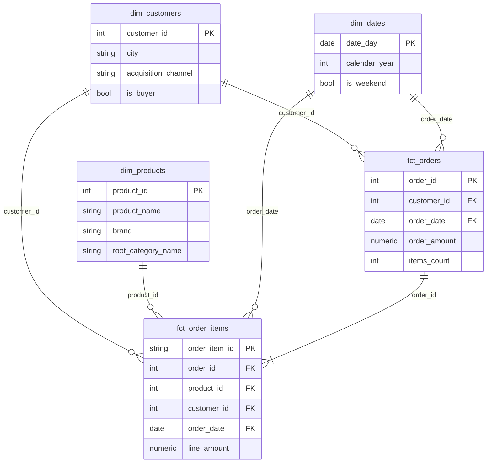
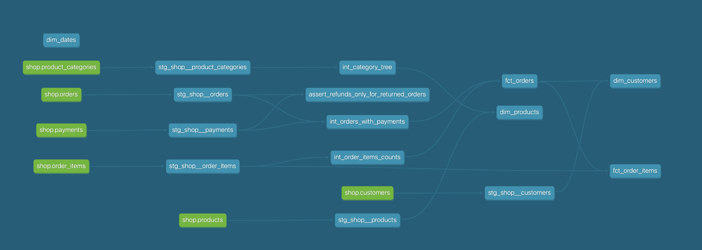

# store_hse: аналитический слой интернет-магазина

схема «звезда»
(staging, intermediate, marts). 

Документация проекта: dbt docs generate && dbt docs serve.

## Запуск

```bash
docker compose down -v && docker compose up -d
docker compose logs loader
docker compose run --rm dbt deps 
docker compose run --rm dbt build
```

## Модель данных



### Витрины

| Витрина           | Зернистость                       | Бизнес-вопрос                                                                   |
|:------------------|:----------------------------------|:--------------------------------------------------------------------------------|
| fct_orders      | один заказ                        | Выручка и средний чек по периодам, городам и каналам; доля возвратов            |
| fct_order_items | один товар в заказе               | Выручка по месяцам и категориям; какие бренды чаще возвращают                   |
| dim_customers   | один клиент, включая не купивших  | Доля покупателей по каналам привлечения; средний чек по городам; первая покупка |
| dim_products    | один товар                        | Срезы по бренду и иерархии категорий (категория, родитель, корень)              |
| dim_dates       | один день                         | Группировка по году, кварталу, месяцу, дню недели и выходным                    |

### Хранение в Greenplum

| Витрина           | Распределение                | Формат      | Почему так                                                                                       |
|:------------------|:-----------------------------|:------------|:-------------------------------------------------------------------------------------------------|
| fct_orders      | distributed by (order_id)  | колоночный   | Ключ уникален и равномерен; совпадает с ключом fct_order_items, JOIN по order_id идёт локально |
| fct_order_items | distributed by (order_id)  | колоночный  | Тот же ключ, что у fct_orders; таблица широкая, отчёты читают 2-3 столбца                      |
| dim_customers   | distributed replicated     | строковый   | Маленькое измерение: копия на каждом сегменте, JOIN с фактами без пересылки строк                |
| dim_products    | distributed replicated     | строковый   | То же                                                                                            |
| dim_dates       | distributed replicated     | строковый   | То же                                                                                            |

Исходные таблицы в raw в Greenplum по умолчанию распределены по случайному ключу (DISTRIBUTED RANDOMLY).
Для фактов fct_orders и fct_order_items мы использовали одинаковый ключ распределения — order_id.

Если ключи были бы разные:
Если бы fct_orders была распределена по order_id, а fct_order_items — по product_id (или вообще случайно), то при их соединении Greenplum пришлось бы пересылать данные между сегментами по сети. Это сильно замедляет запросы. Одинаковый ключ order_id гарантирует, что данные для одного заказа лежат на одном сегменте, и JOIN происходит локально и мгновенно.

### Lineage



## Тесты

Generic-тесты: unique, not_null, relationships (факты к измерениям), accepted_values
(статусы заказа и платежа, корневая категория) и собственный non_negative.
Singular-тесты на бизнес-логику лежат в tests/.


## Дополнительное задание

Второй вариант: подключён пакет dbt_utils (`packages.yml`), календарь dim_dates построен
через dbt_utils.date_spine.